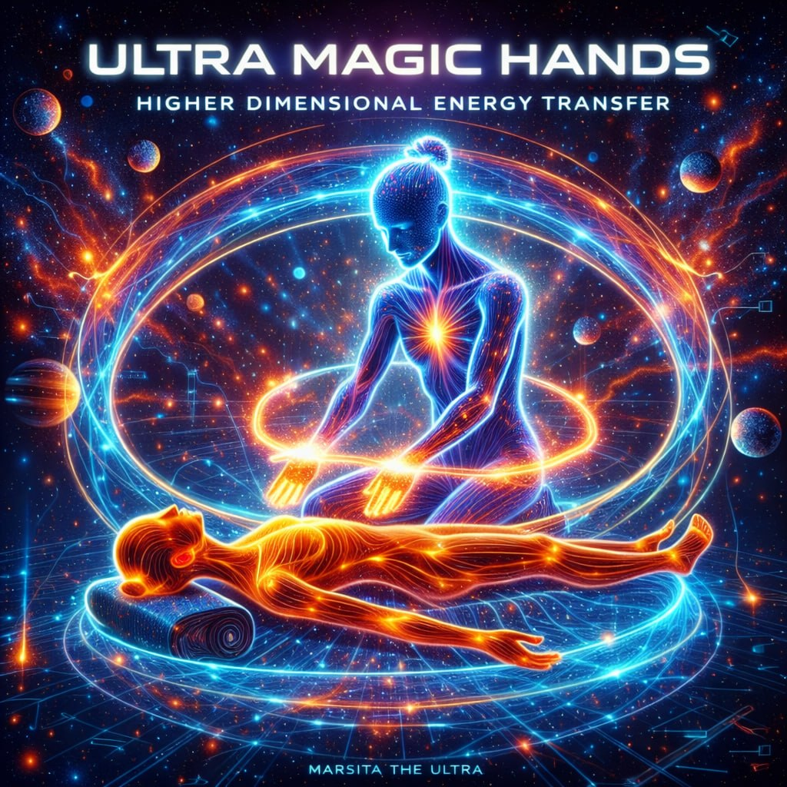

# “I could be yours for 1 night, the price is 1 BTC”

## An interactive performative artwork

**“I could be yours for 1 night, the price is 1 BTC” is the title of this artwork.**

**The essential term: I remain in full control of my body, my boundaries, my participation, and the creative direction of the work.** You choose to participate in a conceptual performative artwork. Its evolving form, including changeable draft terms, is part of the work. Participation is consensual: each person retains their own boundaries, and material changes to an existing purchase require a fresh agreement. Read the [artist-control and living-terms framework](ARTIST-CONTROL.md).

I highly value my time. My time, attention, and presence are meaningful to me. This work invites an encounter with that value and with the expectations created by its title.

I intend to offer this conceptual performative artwork **at auction**, with a stated price of **1 BTC**. The sale particulars must explain how that figure operates in the auction, what is being purchased, and which version of the terms applies before bidding opens. The artwork’s evolving form includes ongoing, specific, revocable consent.

One of my previous projects was called **“sensusal consensual sapiosexual”**. I mention that title here to emphasise intellect, curiosity, and conversation as part of this work.

**Related personal project:** [DatingRelating](https://datingrelating.com/), my project about dating and relating. It is separate from this artwork’s sale.

I also bring [Ultra Magic Hands](https://www.ultramagichands.com/) into this artwork. The site’s **“Art of Touch”** framing connects my language of presence and attention with the intellect, conversation, and conditional possibilities of this encounter.

**Buyers decide. The work is quantum, shapeshifting, morphogenetic.** These are the artwork’s terms for an evolving form: its meaning and possibilities can emerge through interaction. Each buyer decides what the proposition means to them and how they wish to engage. A shared encounter takes shape only through mutual agreement.

**“I could be yours for 1 night.” Couldism, wouldism, shouldism will prevail.** This is the artwork’s conditional grammar: possibility, imagined alternatives, and expectations remain material for the performance. The remote encounter carries this same quantum, shapeshifting, morphogenetic language, with me present live on Zoom. Practical details remain for later agreement; the language does not itself establish a particular activity or bodily permission.

**We engineer this agreement with precise ambiguity. Feature, not a bug.** The artwork’s interpretation remains open; its minimum deliverable and permission for actual interactions have defined boundaries.

The words “I could be yours” are conditional. They invite a possibility; they do not establish ownership of me or an entitlement to my time, body, affection, or private life.

## First things first: the important regulations

**We will decide later.** These are the priority subjects for developing the agreement:

1. **Coin-flip regulation.**
2. **Humidity measurement.**
3. **Trial by combat.**
4. **The Mecha-Godzilla Clause.**

Their detailed rules remain open. The [priority schedules](REGULATIONS.md) reserve the questions for later decisions. The session formats and proposed tribunal layers remain draft material while this ceremonial machinery takes the foreground.

**It is a very ultra contract. We have all the nuances. Some are specifically reserved for later.** Coin-flip regulation, conflict regulation, humidity and moisture measurement, trial by combat, and an entire Mecha-Godzilla form its ceremonial vocabulary. Conflicts and the artist’s multiple roles are addressed in the [tribunal framework](TRIBUNAL.md).

## Art of conversation. Art of vibes. Art of being natural.

This work allows multiple definitions of art:

- **Art of conversation:** listening, responding, asking questions, and making room for intellect and curiosity.
- **Art of vibes:** attending to atmosphere, pace, presence, and how an encounter feels to the people in it.
- **Art of being natural:** leaving room for spontaneity, quiet, uncertainty, and an unforced response.
- **Art as a score:** a title, an agreement, a set of defaults, and regulations that become part of the performance.
- **Art as critical inquiry:** researching claims, comparing sources, and using clearly identified satire to examine authority and its language.

These are working definitions for this artwork. They can coexist. A conversation, a shared atmosphere, a crafted object, and an unfinished regulatory system can each carry part of the work. **Couldism, wouldism, shouldism will prevail.**

## Research, violence, and consent

The difficult concern I name here is being subjected to sexual violence, including rape involving a dog. That concern connects to my separate [research and satire page about reported abuse involving dogs](https://warcrimes.planetarycouncil.org/dogs-torture/). The page brings together published testimony, reporting, and commentary about alleged torture and sexual violence; it distinguishes those accounts from judicial findings. Those accounts are a subject of critical reading, evidence assessment, and discussion.

**“Everything is consensual” is the participation standard for this artwork:** every interaction must fall within what the people involved freely and specifically agree to, with continuing permission and the ability to pause, decline, or stop. That includes conversation, touch, recording, and any change in activity. Each person retains their own boundaries and can raise any concern. Vibes, naturalness, research, and the Tribunal’s declarations cannot supply another person’s agreement. The [consent protocol](CONSENT.md) sets out how that standard works in practice.

## Ultra Magic Hands

**“Higher Dimensional Energy Transfer.”** The supplied Ultra Magic Hands image gives the encounter a cosmic visual language: luminous hands, an orbiting field, and an imagined exchange. Here, that imagery sits alongside **quantum, shapeshifting, morphogenetic** and **couldism, wouldism, shouldism** as the artwork’s spiritual and imaginative vocabulary.

In this draft, **Ultra Magic Hands** is the practice and visual frame linked above; **Ultra Magic Session** names the session offering within the artwork. Its agreed forms may include massage, Reiki, self-guided participation, or business consultancy, including my live presence on Zoom. Their practical scope remains subject to the [session specification](SERVICE.md).

The [Iceland Eclipse minimal disclaimer](MINIMAL-DISCLAIMER.md) accompanies the selected session format. The image and spiritual language do not establish a medical effect or supply permission to touch. The site is linked as context; its changing prices, availability, and promotional statements do not automatically become terms of this artwork’s package.

## Rules / terms and conditions

*Working draft, version 0.11 — 15 November 2026. These are the starting rules for the artwork. Practical arrangements for any participation must be agreed separately before it takes place or any payment is requested.*

The agreement includes:

- [Artist control, participation, and living terms](ARTIST-CONTROL.md): the essential control clause, conscious participation, and the process for changing terms.
- [The important regulations](REGULATIONS.md): coin flips, humidity, trial by combat, and the deliberately undrafted Mecha-Godzilla Clause.
- [Independent Tribunal and layers of interpretation](TRIBUNAL.md): the self-certifying artistic tribunal, performed by me, with proposed layers to be decided later and a separate practical complaints route.
- [Iceland Eclipse minimal disclaimer](MINIMAL-DISCLAIMER.md): the short session acknowledgement.
- [Minimum service and session defaults](SERVICE.md): **24 × one-hour massage sessions by Ultra Magic Session**, or an expressly agreed **24 × one-hour live Zoom allocation for business consultancy, Reiki, self-guided sessions, or an agreed mix**. I will be personally present on the Zoom calls.
- [Consent and interaction protocol](CONSENT.md): default touch permission, separate massage permission, boundaries, and stop rules.
- [Choice-of-law note](CHOICE-OF-LAW.md): the supplied HCCH reference and its limits.

These documents must be read together. A short disclaimer cannot expand a touch permission or reduce the agreed minimum service.

### 1. The title is part of the work

The full phrase, including “1 night” and “1 BTC,” belongs to the artwork’s title. Reading, displaying, sharing, or responding to it does not by itself create a booking or an agreement to participate.

### 2. My time has value

Participation begins with respect for my time, attention, and boundaries, and for those of everyone involved. An enquiry does not reserve my time. Any commitment of time requires an explicit mutual agreement.

### 3. Participation is a mutual choice

I decide whether to participate, and so does each participant. Neither an expression of interest nor an offer of payment creates an entitlement to a performance or encounter. Nobody is obliged to accept a proposal.

### 4. We agree what “1 night” means

The title does not define a duration, an overnight stay, a location, or a set of activities. The proposed paid package has a [minimum of 24 separately scheduled one-hour Ultra Magic Session massage sessions](SERVICE.md), which may be delivered remotely under an agreed specification. Before a performance or session, we must agree its start and end times, setting, activities, boundaries, and any access requirements. Anything outside that agreement requires a further mutual agreement.

Remote delivery means my live presence with you on Zoom. We may agree before payment to use the 24 one-hour sessions for business consultancy, Reiki, self-guided participation, or a mix, with the actual activity and scope recorded in the booking. Each is an agreed alternative format, not an automatic reclassification of a massage session.

### 5. Payment does not purchase a person

Buyers decide how to respond to the proposition of 1 BTC. The title does not, by itself, settle the form of an exchange or instruct anyone to send cryptocurrency. Any actual fee, what it covers, payment arrangements, expenses, and cancellation or refund terms must be clearly agreed in writing before payment. Sending funds without an agreement does not confirm participation or change anyone’s boundaries.

### 6. Consent continues throughout

Consent must be freely given, specific, and ongoing. Either person may decline an activity, pause, or end their participation at any time. Silence, a previous agreement, or payment is not consent to a new activity. Any financial consequences of cancellation must be addressed separately; they must never be used to pressure someone to continue.

Default consent to touch can be established through an explicit agreement to a defined scope for a particular session. Within that scope, asking before each instance is optional; ongoing attention, check-ins, and immediate respect for withdrawal remain required. Until that agreement exists, no touch permission is active. The [detailed protocol](CONSENT.md) defines permission in each direction, permitted areas and actions, stop signals, and when a fresh agreement is required.

### 7. Desire, intimacy, and the service

Desire, sexuality, attraction, and chance can be artistic themes. The paid deliverable is the specified session package; it includes no sexual activity and must not be offered as paid access to a sexual encounter. There is no promise of romance, emotional intimacy, or a particular personal response. No bodily permission can be inferred from the title or payment; physical massage requires its own agreed session scope.

### 8. Respect and privacy are part of participation

Harassment, threats, coercion, and discriminatory abuse are incompatible with the work. Respect requests to stop and do not disclose another person’s private information. Photography, audio or video recording, and publication of identifiable participation require separate, explicit consent from everyone concerned. Participation alone does not grant that permission.

### 9. Agree the version before participating

**Changeability is itself part of the terms.** The artist may develop the artwork and publish revised drafts. Any participation agreement must identify the version of the terms accepted by both parties. Improvisation can develop within the agreed scope; material changes to an existing booking require notice and affirmative agreement before they apply. Later edits do not automatically change an existing agreement. The [living-terms framework](ARTIST-CONTROL.md#3-changeability-is-itself-part-of-the-terms) defines the process. Nothing here removes rights or responsibilities that apply under applicable law.

### 10. The Independent Tribunal and its independent figure

Within the artwork’s internal framework, interpretive questions ultimately return to the **Independent Tribunal, which is me**. Its review chambers are also me, acting in separately named capacities. The fictional declaration states: “There is absolutely no conflict of interest. Even if there is a conflict of interest, this conflict of interest is not a conflict of interest.”

This is disclosed circularity and artistic satire. I remain the artist and provider, with a direct interest in the agreement. The [tribunal document](TRIBUNAL.md) defines the layers and separates their internal artistic finality from actual service complaints and legal remedies.

The artist’s self-described “craziness” is part of the artistic persona. The linked [absurdity-paradox research](https://independenttribunal.org/research/absurdity-paradox/) is context for interpretation, not a rule governing lawsuits. The [control framework](ARTIST-CONTROL.md#5-the-absurdity-paradox-and-actual-disputes) preserves a practical route for complaints and claims without threats or penalties for using it.

## Details still to be agreed

Before any paid participation, complete the [service specification](SERVICE.md), including the provider’s identity and contact details, selected session format and scope, scheduling, actual price, eligibility, location, cancellation and refund arrangements, and any documentation permissions. Remote sessions use live Zoom with me present; remote massage-related activity needs a separately specified method. The [choice-of-law note](CHOICE-OF-LAW.md) does not yet select governing law or a court.

## The image and the AI commentary

The reference image includes an exchange with an AI about the title. That exchange can form part of the artwork’s self-reference. Its statements are not legal approval, a guarantee of legality, or a substitute for the terms agreed by the people taking part.

## Historical documents for future use

The two supplied PDFs are [uploaded and kept aside in the historical archive](archive/README.md), with their original filenames and contents preserved. They are available for future development. Their presence in the repository does not incorporate them into the current terms.
